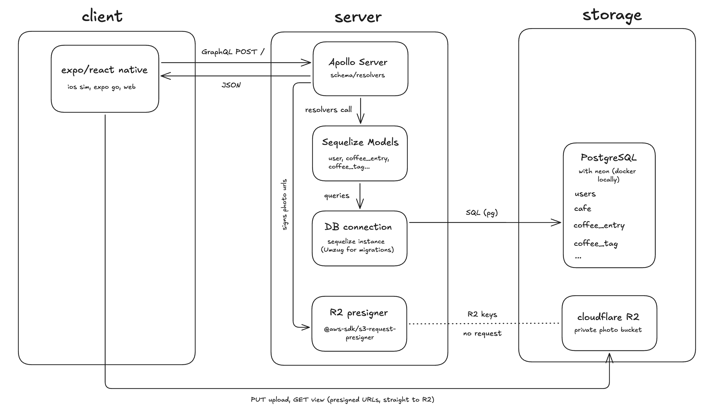

# coffeelog

an app built to keep track of my coffee experiences, built with react expo and a node + apollo server (graphql) backend with sequelize and postgresSQL

## system architecture



this is a high level overview of the `coffelog` system design as a whole. I think the diagram itself is pretty self explanatory with most choices of tooling based on preference and learning purposes.

## prerequisites

- install [mise](https://mise.jdx.dev) which installs and pins node and pnpm version
- docker desktop for running local postgres instance
- Xcode for the ios simulator and installing on a phone (expo go won't work since the app uses native modules like the photo picker)
- a cloudflare r2 bucket for photos (I use `coffeelog-photos-dev` locally and `coffeelog-photos` in prod)

## set up

```sh
mise install
pnpm install
pnpm --dir api install
pnpm --dir app install
cp api/.env.example api/.env # then fill in the R2_* values for your dev bucket
pnpm db:up # start local postgres in docker
pnpm --dir api db:migrate # create database tables
pnpm --dir app ios # build the app and install it on the ios simulator
```

`pnpm --dir app ios` only needs to be run again after adding a package with native code (anything that changes `app.json` plugins or needs a rebuild), otherwise the expo dev server is enough.

## how to run

run each in its own terminal at the root of this repo:

```sh
pnpm dev:api # runs docker compose up then runs dev server at http://localhost:4000
pnpm dev:app # runs expo server, then open the coffeelog app on the simulator
```

## scripts

| Script                                            | What it does                                |
| ------------------------------------------------- | ------------------------------------------- |
| `pnpm dev:api`                                    | start postgres and the api                  |
| `pnpm dev:app`                                    | start expo dev server                       |
| `pnpm db:up` / `pnpm db:down`                     | start/stop postgres                         |
| `pnpm check`                                      | lint, format and import order check (biome) |
| `pnpm check:fix`                                  | same as above but fixes what it can         |
| `pnpm --dir app ios`                              | build and install the app on the simulator  |
| `pnpm --dir app ios:phone`                        | build a release version for my iphone       |
| `pnpm --dir api db:migrate`                       | run pending migrations                      |
| `pnpm --dir api db:migrate:undo`                  | revert last migration                       |
| `pnpm --dir api db:migrate:status`                | list pending migrations                     |
| `pnpm --dir api db:migrate:create --name name.ts` | create a new migration file                 |
| `pnpm --dir api set-password <username>`          | reset a user's password                     |

## deployment

- **api** runs on [fly.io](https://fly.io) (`coffeelog-api`, sydney) from `api/Dockerfile`, migrations run on every deploy
- **database** is postgres on [neon](https://neon.tech)
- **photos** live in a private cloudflare r2 bucket, the api only signs urls and the app uploads/downloads straight from r2

secrets (`DATABASE_URL`, `DATABASE_SSL`, `JWT_SECRET`, `R2_*`) are set on fly with `fly secrets`, never committed.

### ci/cd

- every push to `main` and every pull request runs ci (biome + typecheck for api and app)
- pushing a version tag (`v*.*.*`) runs ci then deploys the api to fly, pushing to `main` does not deploy

### making a release

```sh
git tag v1.2.0
git push origin v1.2.0 # deploys to prod
gh release create v1.2.0 --generate-notes
```

## installing on my iphone

I use a free apple account, so the app has to be reinstalled every 7 days:

1. open `app/ios/coffeelog.xcworkspace` in Xcode and go to the coffeelog target > signing & capabilities (this renews the signing profile), then close Xcode
2. plug the phone in with a cable and run `pnpm --dir app ios:phone`
3. if the phone says the developer isn't trusted, go to settings > general > vpn & device management and trust it

`ios:phone` builds a release version pointed at the prod api, so it doesn't need the dev server running.
