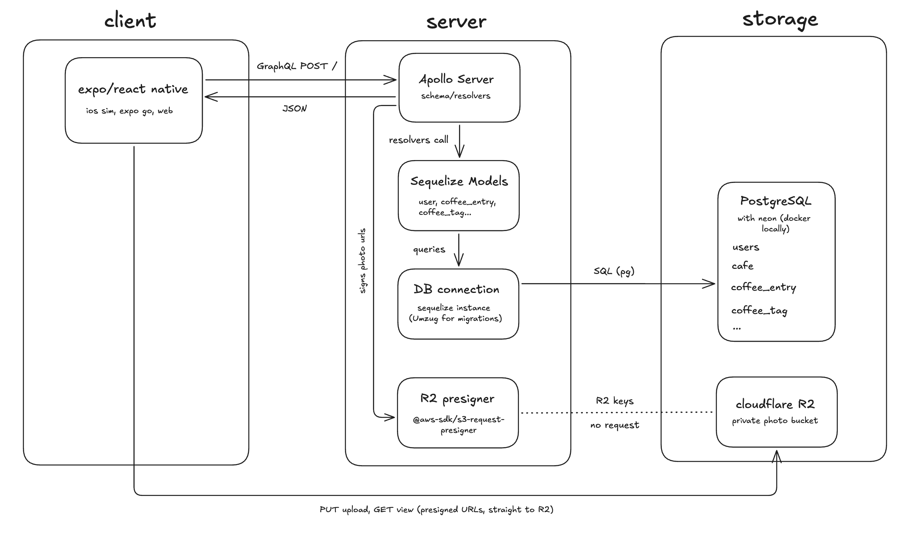
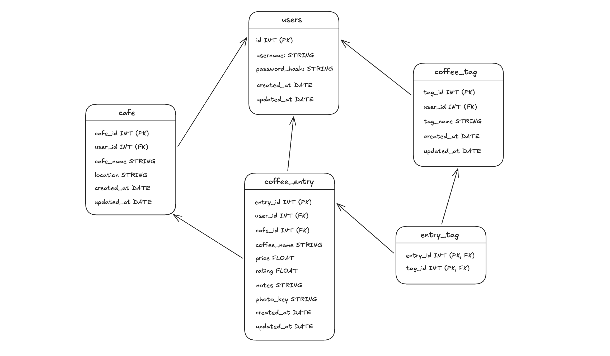

# coffeelog plan

## ideation

Initially, I was looking for a random app idea to create that could improve some of my skills in web development. One idea that came to mind was creating a coffee log application that can track the various types of coffees that I drink at all sorts of cafes around the world.

## type of application

This led to the beautiful idea of `coffeelog`. Firstly, I wanted to map out what type of application it was. I think it made sense for `coffeelog` to be a mobile application as the majority of the time is spent on your phone as opposed to a laptop at a cafe (if you're not studying, of course).

## tech stack

Next came the option of choosing what tech stack to use. I'm already pretty familiar with react and typescript so choosing react native with expo was a suitable choice in terms of a mobile frontend framework. For the backend I was originally going to choose express as my framework. However I felt like I had already accumulated a lot of experience using RESTful apis and wanted something slightly different and new. This led me to the choice of picking a node backend using apollo server for graphql queries.

Next I decided to use a relational database, using postgres and docker locally and postgres and neon for production. The ORM of choice was sequelize, the reasoning behind this was because I was following [fullstackopen](https://courses.mooc.fi/org/uh-cs/courses/full-stack-open-relational-databases) part 13, which taught relational databases using sequelize.

For photo storage I decided to use cloudflare R2 as I've had some experience with s3 but r2 is a much cleaner and cheaper alternative here.

In terms of deployment, the backend service will be deployed on fly and will run my node server from a docker image. The reason I chose this was quite straight forward, fly is a hosting service that I'm familiar with so it should make the deployment workflow much easier.

# system architecture

# database schema

